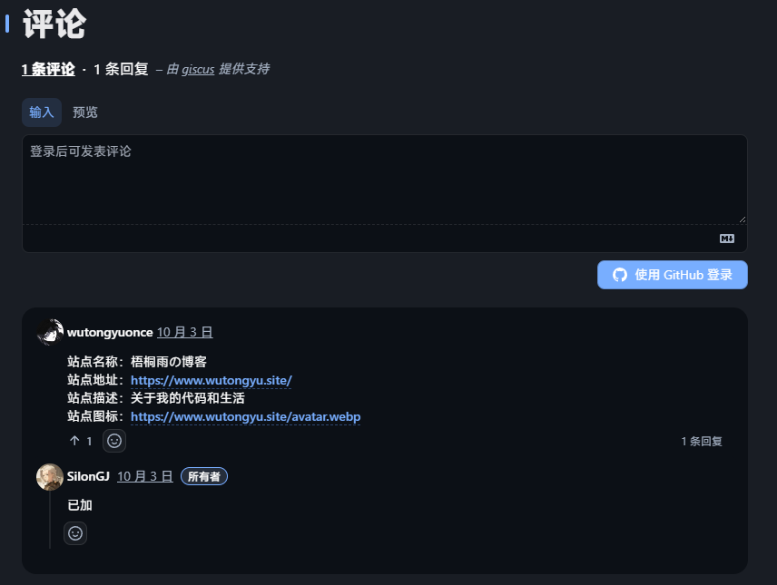

# 关于本仓库
一个自用的 Fuwari 风格 Giscus 主题  
[SilonGJ的个人网站](https://silongj.us.ci/)

# 文件说明
本仓库包含 10 个 CSS 文件，其中 2 个为底层核心文件：
- [dark.css - 深色主题](dark.css)
- [light.css - 浅色主题](light.css)

剩余的文件在核心的基础上补充，主要是**圆角**与**动画**的排列组合。你可以根据个人喜好自由选择：

### 独立修饰文件
如果你只想去掉动画或圆角，可以在核心主题的基础上叠加使用：
- [noanim.css](noanim.css)：全局去除动画效果。
- [norounded.css](norounded.css)：全局直角风格。

### 组合样式文件
图方便懒得写复杂逻辑可以直接引入这些现成组合：

**深色主题：**
- [dark-noanim.css](dark-noanim.css)：深色 + 无动画
- [dark-norounded.css](dark-norounded.css)：深色 + 无圆角
- [dark-norounded-noanim.css](dark-norounded-noanim.css)：深色 + 无圆角 + 无动画

**浅色主题：**
- [light-noanim.css](light-noanim.css)：浅色 + 无动画
- [light-norounded.css](light-norounded.css)：浅色 + 无圆角
- [light-norounded-noanim.css](light-norounded-noanim.css)：浅色 + 无圆角 + 无动画

# 使用方法
1.可使用 CDN 引入，推荐使用 raw.githack.com，因为它可以修正 Github raw 的 MIME 类型，使浏览器正确加载 CSS  
  例如：https://raw.githack.com/SilonGJ/fuwari-giscus-theme/main/dark.css

2.当然，直接把 CSS 文件下载下来定制也是可以的

只需要将 Giscus 配置中的 data-theme 属性改为对应的 CSS 即可应用对应样式，也可以参考 [SilonGJ博客仓库](https://github.com/SilonGJ/blog) 的方法
